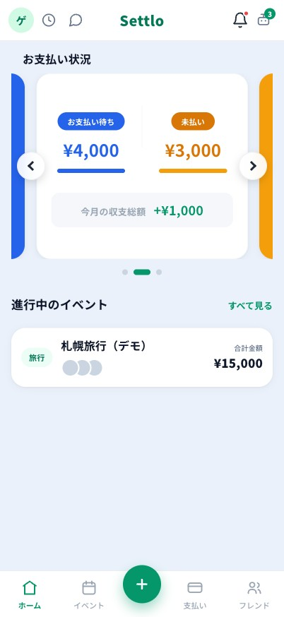
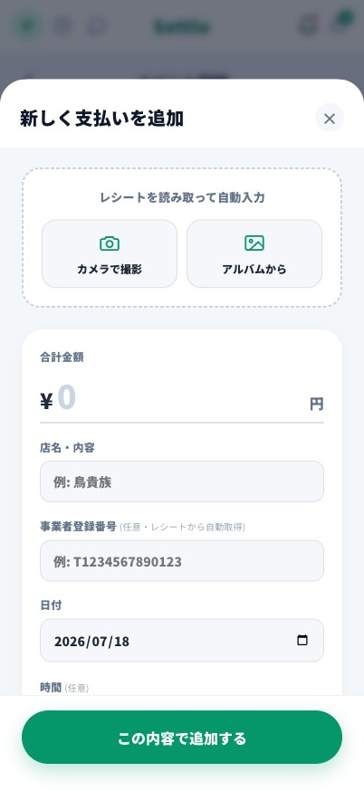
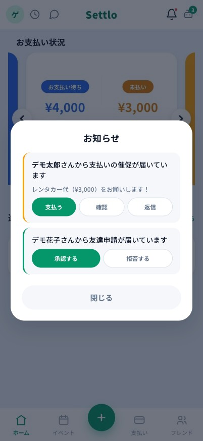

# Settlo（セトロ）

**Settlo** は、旅行やイベントで誰がいくら立て替えたかを記録し、誰が誰にいくら払えばよいかを計算する割り勘アプリです。レシートの読み取りから、支払い後の確認までまとめて扱えます。現金で支払った場合は、受け取った人が確認してから精算が完了します。

[Settloを開く](https://settlo-app.web.app) · ログイン画面の「ゲストとして試す（デモ）」から、アカウント登録なしでサンプルデータを使って試せます。

---

## 📸 スクリーンショット

| ホーム | レシートAI読み取り | まとめて精算 | 通知・催促 |
|:---:|:---:|:---:|:---:|
|  |  |  |  |
| 支払い状況と進行中のイベントをひと目で確認 | 撮影するだけで店名・金額を自動入力 | 相手ごとの貸し借りを合算してまとめて精算 | 催促や友達申請をその場で処理 |

※ 画面はゲストデモ環境のサンプルデータです。

---

## ✨ 主な機能

- 🧾 **レシートAI読み取り** — 撮影するだけで店名・金額・消費税・品目を自動入力（Gemini）。**1回に5枚までまとめて読み取り**、1枚ずつ確認して不要な分は外せる
- 🍽️ **柔軟な割り勘** — 「全員で均等」「金額を指定」「商品ごとに支払う人を選ぶ」の3方式
- 🏷️ **支払いジャンル** — 食事・カフェ・コンビニ・交通など、支払いごとにアイコンで分類
- 🧮 **まとめて精算（2種類）** — イベント内で参加者全員の貸し借りをまとめるか、同じ相手との貸し借りをイベントをまたいでまとめるかを選べる。貸し借りを差し引き、実際に払う金額と相手を表示する
- ➗ **イベントを作らずに1件だけ割り勘** — いつものメンバーで軽く出し合うとき用。記録する前に「誰が誰へいくら」を確認できる
- 👥 **イベント & 参加者管理** — 招待コードで参加、参加者やイベント内容の編集も可能
- 🤝 **フレンド & 取引履歴** — 申請・承認、相手との過去の取引を確認できる
- 🔔 **通知** — 承認リクエスト・催促・拒否をアプリ内＋プッシュで通知（一言メッセージも添えられる）
- 💬 **件ごとのチャット** — 「〇〇の支払いの件」単位で相談。既読・未読バッジつき、解決したら自動で片付く
- 🤖 **AIと返信を考える** — 会話本文と支払いの情報を使い、「PayPayが使える」「いつまでに払う」などの条件に沿った返信案を3つ提案（Gemini）。会話の話者は識別用のラベルに置き換える
- 🔁 **差し戻し（要確認）** — 相手が「受け取っていない」と戻した分を、普通の未払いと分けて表示。次の精算に自動で混ぜない
- ♻️ **元に戻す** — 削除した立て替えを復元できる。復元用の記録は原則7日で整理し、相手の確認待ちの間は残す。非表示にしたイベントはイベント一覧から再表示できる
- ✅ **承認待ちビュー** — 自分が承認する分・相手待ち・承認/拒否の履歴をひと目で。催促中は最上部に強調
- 📊 **精算の進捗表示** — イベントごとに「未精算の残り」と完了率を可視化
- 🎓 **初めての方への案内** — お試しで入ると、押すボタンを1つずつ光らせて7つの機能を案内。3〜5分でひと通り触れる
- 🕹️ **ゲストデモ** — 登録なしでデモデータつきのお試し体験（ログイン画面から）
- 📱 **PWA対応** — ホーム画面に追加して単体アプリとして起動

---

## 🛠️ 技術スタック

| 領域 | 使用技術 |
|---|---|
| フロントエンド | Vue 3（`<script setup>`） / Vite |
| ルーティング | Vue Router（ハッシュルーティング） |
| バックエンド | Firebase 12（Authentication / Firestore / Cloud Functions / Hosting / FCM） |
| Cloud Functions | Node.js 24（asia-northeast1） |
| AI | Gemini 2.5 Flash（レシート読み取り・相談の返信案） |
| ホスティング | Firebase Hosting（PWA） |
| テスト | Node.js 標準のテストランナー |

---

## 🚀 セットアップ（ローカル開発）

```sh
# 1. 依存関係をインストール
npm install

# 2. プロジェクト直下に .env.local を作成し、Firebase の設定（VITE_FIREBASE_*）を記述
#    ※ ファイル名が .env.dev だと Vite が読み込まないので注意（.env.local を使う）

# 3. 開発サーバーを起動
npm run dev          # → http://localhost:5173

# 本番ビルド
npm run build
```

```sh
# テスト（変更を入れる前に毎回通す）
npm test
```

> 現在の挙動は [画面と計算のコード](./src/)・[サーバー処理のコード](./functions/)と [Pull Request の履歴](https://github.com/ryoo-ma638/Settlo/pulls?q=is%3Apr+is%3Amerged)を参照してください。

---

## 🧭 設計で大事にしたこと

- **金額の正データは取引（`transactions`）1本。** 画面に出す数字はそこからしか作らない（同じ金額を2か所で持つとずれるため）
- **現金は相手の承認で完了。** 片方が「払った」と言うだけでは終わらない。承認・拒否の履歴は消さない
- **相手ごとのまとめ精算はサーバーで確定。** 申請・承認・拒否のたびに、対象の取引と関連する記録をまとめて更新する。承認待ちの取引は画面から直接編集・削除できない
- **計算は画面から切り離した純粋な関数に。** そこにテストを書き、金額と状態遷移を固定している

---

## 📁 ディレクトリ構成（抜粋）

```
src/
├─ views/        # 画面（Home / Event / Money / Friend / Login など）
├─ components/   # UI部品（モーダル・カード・アイコン）
├─ composables/  # useSettlement（相手ごとの精算）など
├─ lib/          # 金額・状態の計算（純粋関数）。テストはここに対して書く
├─ assets/       # base.css（デザイントークン）/ main.css
└─ firebase.js   # Firebase 初期化
functions/        # Cloud Functions（レシート読み取り・イベント全体の精算・通知・相談）
tests/            # 金額計算・状態遷移などのテスト
```

---

## 👥 開発

愛知工業大学の学生チームによる開発。サークル内ハッカソン「SysHack」での制作をきっかけに、**技育博2026 Vol.2**（2026年9月19日）に出展しました。
出展で受けた意見を1件ずつ確かめながら、開発を続けています。
